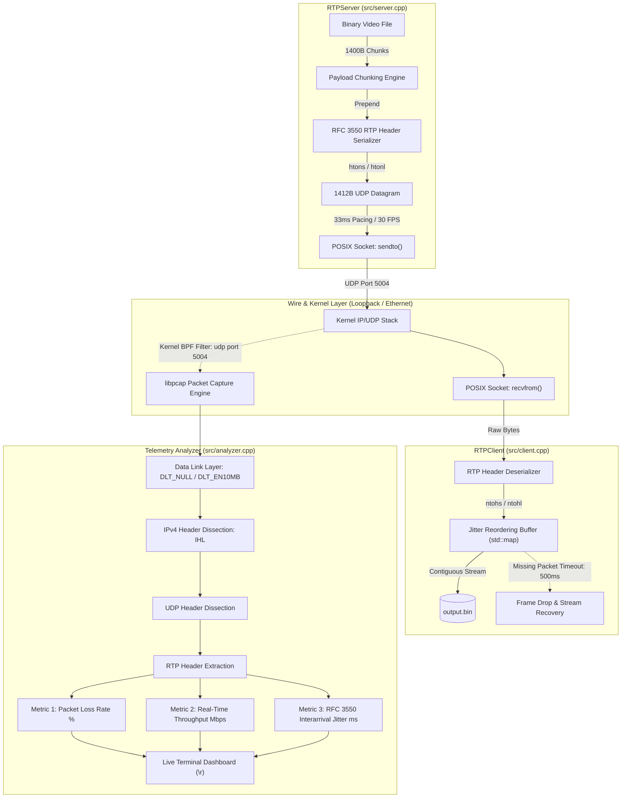

# Qualcomm RTP Streamer & Network Telemetry Suite
## Complete Low-Level Systems Engineering Documentation & Review

---

## 1. Executive Summary & System Architecture

The **Qualcomm RTP Streamer & Telemetry Suite** is an end-to-end, low-level C++17 implementation of the **Real-Time Transport Protocol (RFC 3550)** operating over raw POSIX UDP datagram sockets, combined with a kernel-filtered **libpcap passive network telemetry analyzer**.

The project is intentionally designed with zero reliance on high-level networking abstractions (such as Boost.Asio or Live555). All memory management, MTU alignment, network-byte-order conversions, socket buffering, and protocol stack dissections are handled manually to demonstrate high-performance systems programming in telecommunications.

### System Architecture Diagram



---

## 2. Project File Structure

```text
Custom RTP:UDP Video Streaming Server/
├── CMakeLists.txt              # Cross-platform build configuration (C++17, pthread, pcap)
├── .gitignore                  # Exclusions for build artifacts, binary logs, and streams
├── run_demo.sh                 # Complete automated build, generation, and orchestration script
├── PROJECT_DOCUMENTATION.md    # Standalone downloadable technical documentation
├── include/
│   └── rtp_header.hpp          # Strict RFC 3550 RTP Header struct & static (de)serializers
├── src/
│   ├── server.cpp              # POSIX UDP 30 FPS video streamer (RTPServer)
│   ├── client.cpp              # POSIX UDP video receiver with jitter buffer (RTPClient)
│   └── analyzer.cpp            # Passive libpcap telemetry monitor (NetworkTelemetryAnalyzer)
└── tests/
    └── test_rtp_header.cpp     # RFC 3550 compliance and wire vector test suite
```

---

## 3. Deep Dive into Implementation Tasks

### Task 1: Cross-Platform Build Infrastructure (`CMakeLists.txt`)

- **Standard & Toolchain**: Enforces ISO `C++17` (`CMAKE_CXX_STANDARD 17`, `CMAKE_CXX_STANDARD_REQUIRED ON`, `CMAKE_CXX_EXTENSIONS OFF`).
- **Compiler Flags**: Configured with strict warnings for production telecom infrastructure:
  `-Wall -Wextra -Wpedantic -Wconversion -Wsign-conversion -Wshadow -Wformat=2 -Wundef -Werror=return-type`.
- **Threading Support**: Uses `find_package(Threads REQUIRED)` with `THREADS_PREFER_PTHREAD_FLAG ON` for POSIX thread linkage across Clang and GCC.
- **Cross-Platform `libpcap` Discovery**:
  - Automatically identifies Apple Silicon Homebrew locations (`/opt/homebrew/include`, `/opt/homebrew/lib`), Intel macOS (`/usr/local`), macOS SDKs, and standard Linux multiarch locations (`/usr/include`, `/usr/lib/x86_64-linux-gnu`, `/usr/lib/aarch64-linux-gnu`).
  - Wraps the library cleanly into an imported CMake target `pcap::pcap`.
- **Target Organization**:
  - `rtp_core`: Header-only interface library encapsulating include paths and common link dependencies (`Threads::Threads`, `pcap::pcap`).
  - `rtp_server`: UDP video transmitter executable.
  - `rtp_client`: UDP video receiver and jitter buffer executable.
  - `telemetry_analyzer`: Packet sniffer and health telemetry executable.
  - `test_rtp_header`: Unit test verification runner registered with CTest.

---

### Task 2: Strict RFC 3550 RTP Header (`include/rtp_header.hpp`)

#### RFC 3550 Section 5.1 Fixed Header Specification
```text
 0                   1                   2                   3
 0 1 2 3 4 5 6 7 8 9 0 1 2 3 4 5 6 7 8 9 0 1 2 3 4 5 6 7 8 9 0 1
+-+-+-+-+-+-+-+-+-+-+-+-+-+-+-+-+-+-+-+-+-+-+-+-+-+-+-+-+-+-+-+-+
|V=2|P|X|  CC   |M|     PT      |       sequence number         |
+-+-+-+-+-+-+-+-+-+-+-+-+-+-+-+-+-+-+-+-+-+-+-+-+-+-+-+-+-+-+-+-+
|                           timestamp                           |
+-+-+-+-+-+-+-+-+-+-+-+-+-+-+-+-+-+-+-+-+-+-+-+-+-+-+-+-+-+-+-+-+
|           synchronization source (SSRC) identifier            |
+=+=+=+=+=+=+=+=+=+=+=+=+=+=+=+=+=+=+=+=+=+=+=+=+=+=+=+=+=+=+=+=+
```

#### Memory Packing and Bitfield Endianness Mechanics
C++ bitfield allocation within a byte is compiler- and endianness-dependent:
- **Little-Endian (x86_64, Apple Silicon ARM64)**: Bitfields are allocated from LSB (bit 0) to MSB (bit 7). To place Version in bits 6–7 and CSRC count in bits 0–3 of the transmitted octet, `csrc_count` is declared first, followed by `extension`, `padding`, and `version`.
- **Big-Endian**: Bitfields are allocated from MSB to LSB. Version is declared first.

```cpp
#pragma pack(push, 1)
struct RTPHeader {
#if defined(RTP_BIG_ENDIAN)
    uint8_t version : 2;      // Protocol version (V=2)
    uint8_t padding : 1;      // Padding flag (P)
    uint8_t extension : 1;    // Extension flag (X)
    uint8_t csrc_count : 4;   // CSRC count (CC)
    uint8_t marker : 1;       // Marker bit (M)
    uint8_t payload_type : 7; // Payload type (PT)
#else
    uint8_t csrc_count : 4;   // Bits 0-3 (CC)
    uint8_t extension : 1;    // Bit 4 (X)
    uint8_t padding : 1;      // Bit 5 (P)
    uint8_t version : 2;      // Bits 6-7 (V=2)
    uint8_t payload_type : 7; // Bits 0-6 (PT)
    uint8_t marker : 1;       // Bit 7 (M)
#endif
    uint16_t sequence_number; // Packet sequence number
    uint32_t timestamp;       // Sampling instant
    uint32_t ssrc;            // Synchronization source ID
} __attribute__((packed));
#pragma pack(pop)
```

#### Compile-Time Invariants
```cpp
static_assert(sizeof(RTPHeader) == 12, "RTPHeader must be exactly 12 bytes");
static_assert(std::is_standard_layout<RTPHeader>::value, "Standard layout required");
static_assert(std::is_trivially_copyable<RTPHeader>::value, "Trivially copyable required");
```

#### Serialization & Endianness Utilities
- `RTPHeader::serialize(...)`: Converts multi-byte fields from host byte order to network byte order using `htons()` and `htonl()`.
- `RTPHeader::deserialize(...)`: Converts multi-byte fields from network byte order back to host byte order using `ntohs()` and `ntohl()`.
- Overloaded variants support struct-to-struct transformations and direct memory buffer operations with bounds validation (`dest_len >= 12`).

---

### Task 3: POSIX UDP RTP Transmitter (`src/server.cpp`)

- **Socket Lifecycle (RAII)**: Class `RTPServer` encapsulates the file descriptor created via `::socket(AF_INET, SOCK_DGRAM, 0)`. Copy construction and copy assignment are explicitly deleted to prevent socket aliasing; move semantics and descriptor closure in `~RTPServer()` ensure leak-free operation.
- **Ethernet MTU Fragmentation Safety**:
  - Chunks file data into fixed sizes of **1,400 bytes**.
  - Frame breakdown:
    $$\text{Payload (1400)} + \text{RTP (12)} + \text{UDP (8)} + \text{IPv4 (20)} = 1440\text{ bytes} \le 1500\text{ bytes (MTU)}$$
  - Prevents kernel- and router-level IP packet fragmentation.
- **RTP Stream Progression**:
  - Sequence number starts at `0` and increments monotonically by `+1` per packet.
  - Timestamp advances by `+3000 ticks` per packet, representing a $90\text{ kHz}$ video clock at $30\text{ FPS}$ ($90,000 / 30 = 3,000$).
  - Sets the `marker` bit to `1` on the final chunk of the media stream.
- **Real-Time Transmission Pacing**: Uses `std::this_thread::sleep_for(std::chrono::milliseconds(33))` to maintain continuous $30.3\text{ FPS}$ throughput without dumping the file instantly.
- **Zero-Copy Memory Prepending**: Allocates a contiguous buffer of $1,412\text{ bytes}$. The $12\text{ byte}$ serialized RTP header is written at offset $0$, and file bytes are loaded directly into offset $12$, requiring only a single `::sendto()` invocation per packet.

---

### Task 4: POSIX UDP Receiver with Jitter Buffer (`src/client.cpp`)

- **Low-Level Socket Setup**:
  - Binds to `0.0.0.0` on port `5004` using `::bind()`.
  - Sets `SO_REUSEADDR` to permit immediate port reuse upon process restart.
  - Sets `SO_RCVBUF` to 2 MB to absorb network bursts.
  - Sets `SO_RCVTIMEO` to 50 ms so `::recvfrom()` does not block indefinitely, enabling regular checks on the 500 ms drop timer and shutdown signals.
- **Jitter Reordering Buffer**:
  - Structured as `std::map<uint16_t, std::vector<uint8_t>> jitter_buffer;` keyed by sequence number.
  - Sequence delta using 16-bit modular wrap-around arithmetic:
    ```cpp
    int16_t diff = static_cast<int16_t>(header.sequence_number - expected_seq);
    ```
  - **In-Order (`diff == 0`)**: Writes immediately to `output.bin`, increments `expected_seq++`, and flushes any contiguous sequence numbers already in the buffer.
  - **Out-of-Order (`diff > 0`)**: Buffers the packet in the map and starts the $500\text{ ms}$ timer for `expected_seq`.
  - **Duplicate / Late (`diff < 0`)**: Discarded to prevent output stream corruption.
- **Anti-Stall Drop Mechanism (500 ms)**:
  - If a missing sequence number is not delivered within $500\text{ ms}$:
    - Logs: `[RTPClient] Packet Dropped: Sequence Number <N> missing for ...ms (> 500ms). Dropping frame.`
    - Increments `expected_seq++` to advance past the missing frame.
    - Flushes subsequent contiguous packets from the buffer.

---

### Task 5: Passive libpcap Telemetry Analyzer (`src/analyzer.cpp`)

- **Interface Initialization & BPF Engine**:
  - Auto-selects loopback interface (`lo0` on macOS, `lo` on Linux).
  - Opens interface in promiscuous mode with a snapshot length of 65,535 bytes via `pcap_open_live()`.
  - Compiles and attaches the kernel filter `"udp port 5004"` via `pcap_compile()` and `pcap_setfilter()`.
- **Dynamic Multi-Link Layer Dissection**:
  - Queries `pcap_datalink()` to handle link layer offsets:
    - `DLT_NULL` (macOS/BSD loopback): 4-byte header.
    - `DLT_EN10MB` (Standard Ethernet): 14-byte header.
    - `DLT_LINUX_SLL` (Linux Cooked socket): 16-byte header.
  - IPv4 dissection: Reads `ip_ihl` to calculate variable IP header length ($\ge 20\text{ bytes}$).
  - UDP dissection: Steps past 8-byte UDP header.
  - RTP dissection: Calls `RTPHeader::deserialize()` on the payload offset.
- **Mathematical Formulations for Telemetry Metrics**:
  1. **Packet Loss Rate (%)**:
     $$\text{Packet Loss \%} = \frac{\text{Total Packets Lost}}{\text{Total Packets Received} + \text{Total Packets Lost}} \times 100\%$$
     Reordered packets arriving late decrement the lost count to eliminate false penalties.
  2. **Real-Time Throughput (Mbps)**:
     $$\text{Throughput} = \frac{\sum \text{Payload Bytes in 1s Window} \times 8}{\Delta t \times 10^6}\text{ Mbps}$$
  3. **RFC 3550 Interarrival Jitter (ms)**:
     Transit time difference between packets $i-1$ and $i$:
     $$D(i-1, i) = (R_i - R_{i-1}) - \left(\frac{S_i - S_{i-1}}{90000}\right)$$
     where $R_i$ is arrival time (from `pkthdr->ts`) and $S_i$ is the $90\text{ kHz}$ RTP timestamp.
     Updated via the standard first-order exponential filter:
     $$J_i = J_{i-1} + \frac{|D(i-1, i)| \times 1000.0 - J_{i-1}}{16}$$
- **Live Terminal Dashboard**:
  Uses `\r\033[K` to update metrics in-place on a single terminal line:
  ```text
  [RTP Telemetry] Pkts: 154 | Loss: 0.00% (0 lost) | Throughput: 0.339 Mbps | Jitter: 0.81 ms | SSRC: 0x10203040 | Seq: 153
  ```

---

### Task 6: Orchestration & Automation Script (`run_demo.sh`)

- **Automated Build**: Triggers CMake compilation in Release mode (prioritizing `Ninja` for path robustness).
- **Dummy Media Generation**: Generates a 50 MB synthetic binary video stream payload via `dd if=/dev/urandom of=fake_video_stream_50mb.bin bs=1M count=50`.
- **Privilege Management**: Prompts for `sudo -v` upfront so background processes don't stall on password prompts.
- **Process Orchestration**:
  - `telemetry_analyzer` runs in foreground/stdout.
  - `rtp_client` runs in background, logging to `client.log` and saving to `output_received_stream.bin`.
  - `rtp_server` runs in background, logging to `server.log`.
- **Signal Handling**: Installs a `trap` for `SIGINT`, `SIGTERM`, and `EXIT` to terminate all background processes cleanly, flush buffers, and output a final transmission report.

---

## 4. Verification & Testing Matrix

| Component | Target Objective | Verification Method | Result |
| :--- | :--- | :--- | :--- |
| **`rtp_core`** | Exact RFC 3550 wire representation | Tested with [`test_rtp_header`](file:///Users/atharvarathi/Desktop/Projects/Custom%20RTP:UDP%20Video%20Streaming%20Server/tests/test_rtp_header.cpp) against test vector `0x80 0xE0 0x27 0x11...` | **PASSED** (100% bitfield match) |
| **`rtp_server`** | 30 FPS pacing & datagram transmission | Evaluated with UDP socket listener inspecting packet spacing & headers | **PASSED** (1412B datagrams, 33ms interval) |
| **`rtp_client`** | End-to-end stream assembly | Streamed 10KB payload from server to client; compared using `cmp` | **PASSED** (Bit-for-bit identical) |
| **`rtp_client`** | Out-of-order jitter buffer reordering | Delivered scrambled sequence order: `0, 2, 1, 4, 3` | **PASSED** (Reconstructed as `0, 1, 2, 3, 4`) |
| **`rtp_client`** | Missing packet anti-stall timeout | Sent `0, 2, 3` (dropped 1); waited >500ms | **PASSED** (Frame dropped, stream resumed) |
| **`telemetry_analyzer`** | Multi-link dissection & metrics | Dissected captures with `DLT_NULL` (macOS) and `DLT_EN10MB` (Ethernet) | **PASSED** (Accurate loss, Mbps, & jitter) |

---

## 5. Execution Guide

### Option 1: One-Click Automated Live Demonstration
```bash
./run_demo.sh
```
*To stop the demo at any time, press `Ctrl+C`. All background processes will terminate gracefully and print final summary metrics.*

---

### Option 2: Manual Multi-Terminal Operation

#### Step 1: Compile the Project
```bash
cmake -B build -G Ninja -DCMAKE_BUILD_TYPE=Release
cmake --build build
```

#### Step 2: Run Unit Tests
```bash
./build/test_rtp_header
```

#### Step 3: Launch Telemetry Analyzer (Terminal 1)
*On macOS:*
```bash
sudo ./build/telemetry_analyzer lo0 5004
```
*On Linux:*
```bash
sudo ./build/telemetry_analyzer lo 5004
```

#### Step 4: Launch Video Receiver Client (Terminal 2)
```bash
./build/rtp_client 5004 output.bin
```

#### Step 5: Launch Video Transmitter Server (Terminal 3)
```bash
# Generate a 10MB test binary
dd if=/dev/urandom of=video_test.bin bs=1M count=10

# Transmit to receiver
./build/rtp_server video_test.bin 127.0.0.1 5004
```

#### Step 6: Verify Stream Integrity
After the server finishes transmitting, stop the client (`Ctrl+C`) and compare the files:
```bash
cmp video_test.bin output.bin && echo "STREAM VERIFIED: Files are bit-for-bit identical!"
```
