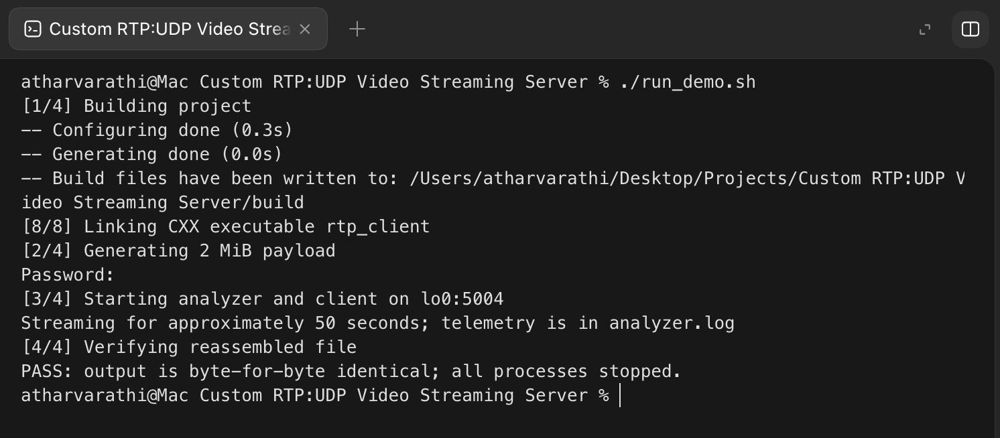
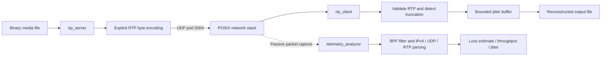

<div align="center">

# RTP/UDP Streaming Server & Packet Analyzer

**C++17 systems programming · POSIX networking · Real-time transport telemetry**

A custom RTP transmitter, bounded-buffer receiver, and passive packet analyzer built directly on POSIX UDP sockets and libpcap.


[Demo](#demo) · [Architecture](#architecture) · [Systems Hardening](#systems-hardening) · [Quick Start](#quick-start) · [Testing](#testing) · [Source Guide](#source-guide)

</div>

---

## Overview

This project makes the mechanics of real-time transport visible: encoding a packet header, sending paced UDP datagrams, handling reordered sequences, bounding memory, and measuring traffic independently of the application.

The implementation keeps socket ownership, wire-format conversion, packet validation, buffering, and shutdown behavior explicit. It uses **no high-level networking framework** such as Boost.Asio or Live555.

| Component | Responsibility | Core mechanisms |
| :--- | :--- | :--- |
| **Transmitter** — `rtp_server` | Packetize and transmit a binary media payload | `socket()`, `sendto()`, explicit RTP encoding, 33 ms pacing |
| **Receiver** — `rtp_client` | Validate packets and reconstruct ordered payload data | `bind()`, `recvmsg()`, `MSG_TRUNC`, bounded jitter buffer |
| **Analyzer** — `telemetry_analyzer` | Observe traffic without participating in delivery | libpcap, BPF filtering, packet dissection, live metrics |

**Development platform:** macOS on Apple Silicon. **Deployment target:** Embedded Linux. The implementation uses portable byte encoding and POSIX APIs; validation on a specific Linux board/toolchain remains a deployment step.

## Demo

The screenshot below shows a real macOS loopback run: successful compilation, a **2 MiB** transfer, automatic process teardown, and a **byte-for-byte match** between source and reconstructed output.



```text
[1/4] Building project
[2/4] Generating 2 MiB payload
[3/4] Starting analyzer and client on lo0:5004
Streaming for approximately 50 seconds; telemetry is in analyzer.log
[4/4] Verifying reassembled file
PASS: output is byte-for-byte identical; all processes stopped.
```

The comparison demonstrates integrity for this loss-free run. UDP delivery itself remains best effort.

## Architecture



### Packet lifecycle

1. The server reads up to **1400 payload bytes**, prepends a **12-byte RTP fixed header**, and sends one UDP datagram.
2. The sequence number increments per packet; the RTP timestamp advances by **3000 ticks** on a **90 kHz clock**. A **33 ms** delay simulates approximately 30 packet transmissions per second.
3. The client rejects truncated datagrams and invalid RTP packets before extracting the payload. Supported CSRC lists, header extensions, and padding are length-checked and excluded from payload output.
4. In-order packets are written immediately. Future packets within the reorder window are buffered, and contiguous buffered packets are drained when a gap closes.
5. A missing sequence is skipped after **500 ms**. A packet beyond the reorder bound clears pending buffered data and resynchronizes the receiver to bound memory and latency.
6. The analyzer independently captures matching UDP traffic and updates its terminal dashboard.

### Transport parameters

| Parameter | Default | Design intent |
| :--- | :--- | :--- |
| UDP port | `5004` | Configurable through each executable's CLI |
| RTP version / payload type | `2` / `96` | PT 96 is this application's configured dynamic payload format |
| Fixed RTP header | `12 bytes` | Encoded independently of host struct layout |
| Payload chunk | `1400 bytes` | Leaves headroom within a conventional 1500-byte IPv4 MTU |
| Packet pacing | `33 ms` | Demonstrates a paced multimedia transport pipeline |
| RTP clock / timestamp step | `90 kHz` / `3000` | Simulated sampling clock |
| Receive buffer per datagram | `2048 bytes` | Larger datagrams are detected and dropped |
| Jitter buffer | Up to `64 packets`, maximum `64` sequences ahead | Bounds retained out-of-order payload data |
| Missing-packet timeout | `500 ms` | Prevents indefinite waiting on a sequence gap |

At the configured pacing, payload throughput is approximately **0.34 Mbps** and a 2 MiB transfer takes about **50 seconds**, plus startup and teardown. This is the demo's configured rate, not a maximum-throughput benchmark.

## Systems Hardening

| Engineering feature | Implementation | Why it matters |
| :--- | :--- | :--- |
| **Cross-Platform Portability** | Bypassed compiler-dependent C++ bitfields by implementing strict byte encoding with bitwise operations (`<<`, `>>`, `&`, `\|`) for the RFC 3550 RTP header. | The wire format is independent of compiler bitfield allocation, host endianness, struct padding, and alignment. |
| **Memory Safety** | Replaced `recvfrom()` with `recvmsg()` to actively detect and drop silently truncated UDP datagrams using `MSG_TRUNC`. | An oversized datagram cannot be mistaken for a complete application packet. |
| **Embedded Resource Limits** | Implemented a strictly bounded **64-packet jitter buffer window** to prevent out-of-order network bursts from causing unbounded buffering and associated Out-Of-Memory (OOM) failures. | Excessive sequence distance triggers buffer clearing and resynchronization; retained payload memory stays bounded. |
| **POSIX Signal Safety** | Uses `sigaction()` with syscall restarting disabled. Handlers set only a `volatile sig_atomic_t` flag; libpcap handles stay outside signal handlers. | Supports predictable syscall interruption and safe libpcap teardown without dangling capture pointers. |

Additional safeguards include:

- **Shared RTP validation:** version 2, configured payload type, fixed header length, CSRC lengths, extension lengths, and padding counts.
- **Capture bounds checks:** rejects malformed/truncated IPv4 and UDP lengths and fragmented IPv4 datagrams; unsupported link types fail explicitly.
- **Portable sequence arithmetic:** handles 16-bit sequence wraparound within the bounded comparison window.
- **Explicit resource ownership:** socket classes close descriptors and disable copying; the analyzer closes its capture handle during normal object teardown.
- **Checked failure paths:** output writes and close operations are checked, interrupted sends are retried while running, and invalid CLI ports produce errors.
- **Responsive analyzer shutdown:** nonblocking capture dispatch and a bounded idle wait allow termination even when no packets arrive.

## Quick Start

### Prerequisites

- A C++17 compiler: Apple Clang, Clang, or GCC
- CMake **3.16+** and Ninja
- libpcap development headers and library
- Python 3 for the optional integration test suite
- Bash and `sudo` for the complete live-capture demo

**macOS**

```bash
xcode-select --install  # If Command Line Tools are not installed
brew install cmake ninja libpcap python
```

**Debian / Ubuntu**

```bash
sudo apt-get update
sudo apt-get install build-essential cmake ninja-build libpcap-dev python3
```

### Clone and run

```bash
git clone https://github.com/AtharvaRathi/Custom-RTP-UDP-Video-Streaming-Server-Packet-Analyzer.git
cd Custom-RTP-UDP-Video-Streaming-Server-Packet-Analyzer
./run_demo.sh
```

The script selects `lo0` on macOS or `lo` on Linux. An interface can also be supplied explicitly:

```bash
./run_demo.sh lo0  # macOS
./run_demo.sh lo   # Linux
```

The demo builds the project, generates fresh random input, requests capture privileges, waits for receiver readiness, streams the file, sends `SIGINT` to the receivers, waits for their exit, and runs `cmp`. Interrupting the script also triggers cleanup.

| Generated file | Contents |
| :--- | :--- |
| `fake_video_stream_2mb.bin` | 2 MiB random source payload |
| `output_received_stream.bin` | Reconstructed receiver output |
| `server.log` | Transmitter progress and errors |
| `client.log` | Receiver progress, packet drops, and shutdown summary |
| `analyzer.log` | Telemetry dashboard output and final summary |

Build outputs, `.bin` media, logs, and packet captures are excluded from Git through [`.gitignore`](.gitignore). The screenshot is committed as a documentation asset.

## Manual Operation

### Build

```bash
cmake -B build -G Ninja -DCMAKE_BUILD_TYPE=Release
cmake --build build
```

Run the following in separate terminals, starting the analyzer and receiver before the transmitter.

**Terminal 1 — passive analyzer**

```bash
sudo ./build/telemetry_analyzer lo0 5004  # Use lo on Linux
```

**Terminal 2 — receiver**

```bash
./build/rtp_client 5004 output.bin
```

**Terminal 3 — transmitter**

```bash
dd if=/dev/urandom of=video_test.bin bs=1048576 count=2
./build/rtp_server video_test.bin 127.0.0.1 5004
```

After transmission completes, allow pending packets to drain, then press **Ctrl+C** in the receiver and analyzer terminals. Verify the closed output file:

```bash
cmp video_test.bin output.bin && echo "PASS: files are identical"
```

The client remains active until signaled; it does not treat the final marker as a shutdown command. `run_demo.sh` automates this lifecycle.

### Command reference

```text
rtp_server         [filepath] [dest_ip] [dest_port]
rtp_client         [listen_port] [output_file]
telemetry_analyzer [options] [interface] [port]

Analyzer options:
  --file <pcap>    Analyze an offline capture instead of opening an interface
  -h, --help       Display usage
```

Each executable accepts `--help`. Default destination is `127.0.0.1:5004`; the receiver binds all local IPv4 interfaces. The server creates sample media if its requested input file is missing.

**Offline analysis — no live-capture privileges required**

```bash
./build/telemetry_analyzer --file capture.pcap lo0 5004
```

In offline mode, the capture file replaces the interface as the input source; the positional interface is retained to supply the optional port in the existing CLI format.

## Telemetry

The analyzer applies the BPF filter `udp port <port>` and parses supported link-layer headers followed by IPv4, UDP, and RTP. Supported link types are **BSD/macOS loopback (`DLT_NULL`)**, **Ethernet**, **`DLT_LOOP`**, and **Linux cooked capture (`DLT_LINUX_SLL`)**.

| Metric | Meaning |
| :--- | :--- |
| Packets | Accepted RTP packets observed by the analyzer |
| Packet loss (%) | Estimate derived from observed sequence gaps and later arrivals |
| Throughput (Mbps) | Accepted payload bytes over the current processing-time window |
| Jitter (ms) | Smoothed interarrival transit variation using capture timestamps and the 90 kHz RTP clock |
| SSRC / sequence | Most recently observed stream identifier and sequence number |

These metrics are intended for inspecting a single controlled stream. Duplicate packets can distort the simple loss estimate, streams are not tracked independently by SSRC, and RTP timestamp wraparound is not yet normalized for jitter. Offline throughput reflects replay processing speed; the summary's throughput field reflects the latest window rather than a whole-session average.

## Testing

```bash
ctest --test-dir build --output-on-failure
```

The C++ header suite uses checks that remain active in **Release** builds. CMake registers the Python integration suite when a Python 3 interpreter is available. Integration tests use temporary files, unprivileged loopback UDP, and synthetic offline captures; **sudo is not required**.

| Suite | Coverage |
| :--- | :--- |
| `test_rtp_header` | Exact wire-byte vector, encode/decode, short and null buffers, CSRC/extension/padding validation, invalid version/type, sequence arithmetic |
| `test_pipeline` | Malformed packet rejection, datagram truncation, reordering, duplicates, wraparound, jitter-window resynchronization, loss timeout, signal handling, file transfer, offline parsing, CLI errors |

**Validation performed on macOS / Apple Silicon:** Release tests and Debug tests with AddressSanitizer + UndefinedBehaviorSanitizer passed. The demo screenshot above records a complete 2 MiB loopback transfer.

<details>
<summary><strong>Run with AddressSanitizer and UndefinedBehaviorSanitizer</strong></summary>

```bash
cmake -S . -B build_sanitize -G Ninja \
  -DCMAKE_BUILD_TYPE=Debug \
  -DCMAKE_CXX_FLAGS="-fsanitize=address,undefined -fno-omit-frame-pointer" \
  -DCMAKE_EXE_LINKER_FLAGS="-fsanitize=address,undefined"
cmake --build build_sanitize
ctest --test-dir build_sanitize --output-on-failure
```

Requires a compiler/toolchain with the corresponding sanitizer runtimes.

</details>

## Source Guide

```text
.
├── CMakeLists.txt            # C++17 targets, dependencies, warnings, CTest
├── README.md                # Project overview and reproducible workflow
├── PROJECT_DOCUMENTATION.md # Earlier development notes
├── include/
│   ├── rtp_header.hpp        # Explicit wire encoding and shared RTP validation
│   └── posix_utils.hpp       # Signal handlers and port validation
├── src/
│   ├── server.cpp            # Paced UDP transmitter
│   ├── client.cpp            # Validating receiver and bounded jitter buffer
│   └── analyzer.cpp          # Passive capture and transport telemetry
├── tests/
│   ├── test_rtp_header.cpp   # Wire-format and validation checks
│   └── test_pipeline.py      # Loopback and offline-capture regressions
├── docs/images/
│   └── demo-macos.png        # Actual end-to-end execution screenshot
└── run_demo.sh               # Build, stream, stop, and compare
```

The source and this README describe the current hardened implementation. `PROJECT_DOCUMENTATION.md` retains earlier development notes, including design details that predate the byte-encoding refactor.

## Scope and Next Steps

This is a systems engineering demonstration of RTP packet transport and inspection. It streams binary chunks with simulated media timing; a codec encoder/decoder, video playback, codec-specific RTP payload format, RTCP, retransmission, congestion control, and SRTP are outside the current implementation.

The receiver favors bounded memory and forward progress: lost or discarded payload cannot be reconstructed, and byte-for-byte output equality requires a loss-free run. Source/SSRC isolation, per-stream telemetry, timestamp rollover handling, and validation on the target Embedded Linux hardware are natural next steps.

## Author

**[Atharva Rathi](https://github.com/AtharvaRathi)**

Built to demonstrate C++ systems engineering across packet serialization, POSIX socket programming, bounded buffering, protocol validation, resource ownership, and observable network behavior.
